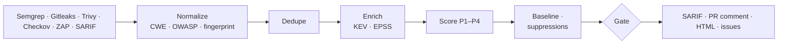

<div align="center">

# 🛡️ breachgraph

**One security gate for your CI pipeline.**

Runs Semgrep, Gitleaks, Trivy, Checkov and OWASP ZAP in one step. Duplicates are merged, every
finding is ranked by real-world exploitability (CISA KEV + EPSS), and the build fails only on
what matters: *new* issues above your threshold.

[](https://github.com/OWNER/breachgraph/actions/workflows/ci.yml)
[](https://github.com/OWNER/breachgraph/actions/workflows/self-scan.yml)
[](LICENSE)
[](pyproject.toml)

</div>

---

## Why

Running scanners in CI is easy. Living with their output is not:

- **Noise.** Five tools produce 300 findings, and the same misconfiguration shows up two or three times.
- **No priority.** Hundreds of "critical" CVSS scores, and nothing says which one is actually exploited in the wild.
- **All-or-nothing gates.** Turning on blocking mode on an existing repo fails every PR on day one, so teams turn it off.
- **Scattered results.** Five report formats in five places, and developers read none of them.

breachgraph fixes this with a **normalize → dedupe → enrich → score → policy** pipeline on top of the
open-source scanners you already trust.

## What you get

| | |
|---|---|
| 🔍 **Coverage** | SAST (Semgrep) · secrets (Gitleaks) · dependency CVEs, IaC, container images, licenses (Trivy) · IaC (Checkov) · DAST (ZAP) · plus **any SARIF** tool (CodeQL, Bandit, gosec…) via `--import` |
| 🧹 **Deduplication** | Cross-tool clustering (e.g. Trivy `AVD-DS-0002` ≡ Checkov `CKV_DOCKER_3`) and same-tool rule overlap. In the demo app, 227 raw results become 201 findings without merging distinct issues |
| 🎯 **Risk-based priority** | CVSS/severity adjusted by **CISA KEV** (actively exploited → always P1), **FIRST EPSS** exploit probability, confidence, multi-tool agreement and test-code paths. Every score explains itself |
| 🚦 **Gate that teams keep on** | Content-based fingerprints + **baselines**, so only *new* findings fail the build. **Suppressions require a reason and an expiry date** |
| 💬 **Feedback where developers are** | Sticky PR comment · inline code-scanning annotations (SARIF) · job summary · auto-managed GitHub issues for P1s |
| 📦 **Reports** | SARIF 2.1.0 · JSON · self-contained HTML · Markdown · JUnit · CycloneDX SBOM |
| 🔒 **Trustworthy itself** | Scanner binaries pinned and SHA-256 verified · actions pinned to commit SHAs · signed images with SBOM + provenance · secrets always redacted · untrusted scanner output escaped |

<p align="center"></p>

## Quick start

### GitHub Actions

```yaml
# .github/workflows/breachgraph.yml
name: breachgraph
on: [pull_request, push]
permissions:
  contents: read
  security-events: write   # code scanning upload
  pull-requests: write     # PR comment
jobs:
  breachgraph:
    runs-on: ubuntu-latest
    steps:
      - uses: actions/checkout@v7
      - uses: OWNER/breachgraph@v0
```

More recipes (baselines, DAST, container images, issue tracking) are in [docs/github-action.md](docs/github-action.md).

### Docker (any CI, or your laptop)

```bash
docker run --rm -v "$PWD:/src" ghcr.io/OWNER/breachgraph scan .
open breachgraph-report/breachgraph.html
```

### pip

```bash
pip install breachgraph
breachgraph doctor          # shows which scanners are on PATH
breachgraph scan .
```

The pip package only orchestrates. It runs whichever scanners are installed and skips the rest.
The Docker image bundles all of them at pinned versions.

### GitLab CI

```yaml
include:
  - remote: https://raw.githubusercontent.com/OWNER/breachgraph/v0/templates/gitlab-ci.yml
```

## Try it on the demo app

[`examples/vulnerable-app`](examples/vulnerable-app) is an intentionally vulnerable Flask app
with Terraform, Kubernetes and Dockerfile misconfigurations, fake secrets and Log4Shell:

```bash
docker run --rm -v "$PWD:/src" ghcr.io/OWNER/breachgraph scan examples/vulnerable-app
```

```
      ok gitleaks     2 findings     0.7s
      ok checkov     50 findings     8.2s
      ok semgrep     26 findings     9.2s
      ok trivy      149 findings    25.5s
| Prio | Risk | Finding                                                      | Location     | Tools            | Status     |
| P1   | 10.0 | CVE-2021-44228 in log4j-core 2.14.1: Remote code exec  KEV   | pom.xml:11   | trivy            | BLOCKS new |
| P1   | 10.0 | Hardcoded secret: Identified a Private Key                   | settings.py:6| gitleaks,semgrep | BLOCKS new |
...
Gate failed: 104 finding(s) at or above the threshold (priority >= P2, any KEV, any secret)
```

## Adopting it on an existing codebase

```bash
# 1. Accept what exists today
breachgraph scan --write-baseline .breachgraph-baseline.json && git add .breachgraph-baseline.json

# 2. Turn the gate on. From now on only NEW findings fail PRs.
# 3. Burn down the baseline over time; accepted risks go into .breachgraph.yml with an expiry:
```

```yaml
# .breachgraph.yml
fail_on:
  priority: P2        # new P1/P2 findings fail the build
  kev: true           # so does anything actively exploited
  secrets: true       # and any hardcoded secret
suppressions:
  - vuln: CVE-2023-12345
    reason: "Vulnerable code path not reachable; tracked in SEC-142"
    expires: 2026-12-31
```

Full reference: [docs/configuration.md](docs/configuration.md).

## How it works



Design notes and how to add a scanner: [docs/architecture.md](docs/architecture.md).

## CLI

```
breachgraph scan [PATH]      Scan and gate
  -c, --config FILE        .breachgraph.yml (auto-detected)
  -b, --baseline FILE      accepted findings (auto-detected .breachgraph-baseline.json)
  --write-baseline FILE    accept all current findings
  -f, --format LIST        json,sarif,html,md,junit
  --only / --skip LIST     choose scanners
  --import TOOL=FILE       ingest existing reports (semgrep, gitleaks, trivy, checkov, zap, sarif)
  --fail-on P1..P4|none    override the threshold
  --dast-url URL           run ZAP against a running app
  --image REF              scan a container image
  --github-comment         sticky PR comment
  --github-issues P1       open/close issues per finding
  --offline                skip KEV/EPSS
  --no-fail                report only
breachgraph report results.json   re-render reports, optionally with a new policy
breachgraph doctor                show installed scanners
breachgraph init                  write a starter .breachgraph.yml and workflow
```

Exit codes: `0` pass · `1` gate failed · `2` usage/config error · `3` scanner error (opt-in).

## Roadmap

- [ ] AI-assisted triage plugin: LLM explanations and fix suggestions grounded in scanner evidence, with a cost cap
- [ ] Reachability hints for dependency CVEs (is the vulnerable function imported?)
- [ ] OSV-Scanner and Grype adapters
- [ ] GitLab merge request notes and code quality report
- [ ] Trend history across runs

## Contributing

Issues and PRs are welcome. See [CONTRIBUTING.md](CONTRIBUTING.md). To report a vulnerability in
breachgraph itself, see [SECURITY.md](SECURITY.md).

## License

[Apache-2.0](LICENSE). The bundled scanners keep their own licenses: Semgrep CE (LGPL-2.1),
Gitleaks (MIT), Trivy (Apache-2.0), Checkov (Apache-2.0), ZAP (Apache-2.0).
