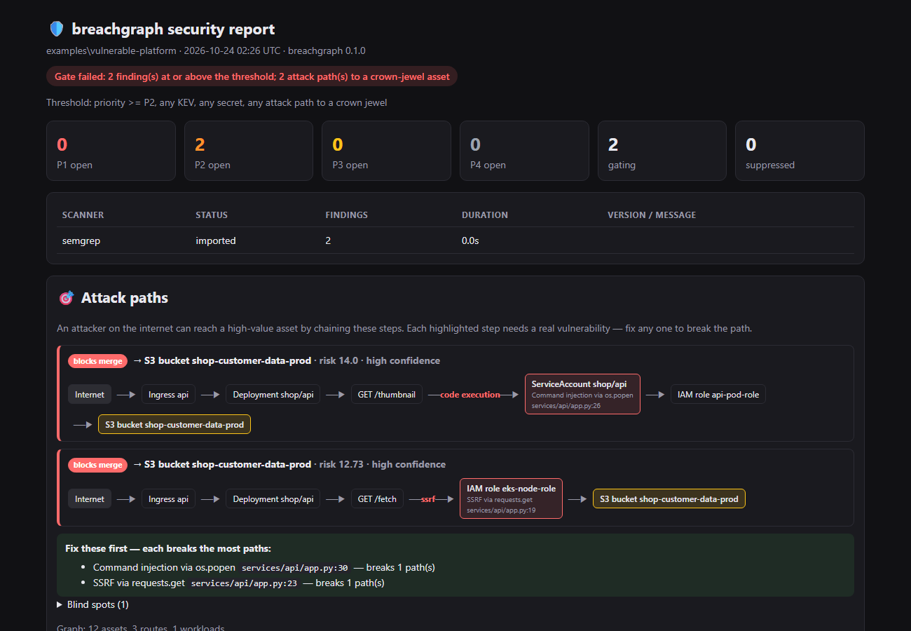
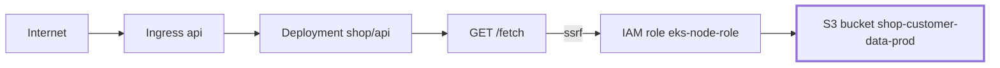

# breachgraph

**Find the few security findings an attacker can actually chain into a breach.**

**[Open the live demo](https://amoghnellutla.github.io/breachgraph/)**: the real report for a small
vulnerable platform (Flask on EKS, Terraform, GitHub Actions). Click a path to trace it, or mark a
finding as fixed and watch the paths it breaks disappear. Nothing to install.

[](https://github.com/amoghnellutla/breachgraph/actions/workflows/ci.yml)
[](https://scorecard.dev/viewer/?uri=github.com/amoghnellutla/breachgraph)
[](https://pypi.org/project/breachgraph/)
[](LICENSE)

breachgraph runs Semgrep, Gitleaks, Trivy, Checkov and zizmor on your repository, then reads your
code, Kubernetes manifests, Terraform (AWS, Azure, GCP) and GitHub Actions workflows to build one
graph of how they connect. It reports the **attack paths**: an SSRF on a public route, in a pod on a
node whose role can read the customer bucket, is a breach, even though each scanner saw only one
piece of it. On a pull request it answers one question first: does this change open a new way in?

## Results on real projects

breachgraph was run with default settings on eight public projects: deliberately vulnerable
training projects, where the real attack chains are documented, and Google's Online Boutique as a
healthy control. Every path it reported was checked by hand.

| Project | Findings after dedupe | Attack paths | Real |
|---|---:|---:|---:|
| [terragoat](https://github.com/bridgecrewio/terragoat) | 1,088 | 2 | 2 |
| [kubernetes-goat](https://github.com/madhuakula/kubernetes-goat) | 795 | 0 | 0 |
| [cloudgoat](https://github.com/RhinoSecurityLabs/cloudgoat) | 1,446 | 1 | 1 |
| [awsgoat](https://github.com/ine-labs/AWSGoat) | 785 | 3 | 3 |
| [azuregoat](https://github.com/ine-labs/AzureGoat) | 504 | 2 | 2 |
| [gcpgoat](https://github.com/ine-labs/GCPGoat) | 411 | 5 | 4 |
| [juice-shop](https://github.com/juice-shop/juice-shop) | 411 | 2 | 2 |
| [online-boutique](https://github.com/GoogleCloudPlatform/microservices-demo) (control) | 878 | 0 | 0 |
| **Total** | **6,318** | **15** | **14** |

6,318 findings come down to 15 attack paths, and 14 of them are real chains an attacker could use
(93% precision). The control project gets none. The method, every path with the reason it is or
isn't real, the scenarios breachgraph missed, and what it finds from a leaked key or a foothold
inside the cluster are in [docs/benchmark.md](docs/benchmark.md). Anyone can rerun it.

<p align="center"></p>

## Quick start

On GitHub, add a workflow:

```yaml
# .github/workflows/breachgraph.yml
name: breachgraph
on:
  pull_request:
  push:
    branches: [main]
permissions:
  contents: read
  security-events: write   # findings in code scanning
  pull-requests: write     # the PR comment
jobs:
  breachgraph:
    runs-on: ubuntu-latest
    steps:
      - uses: actions/checkout@v7
        with:
          persist-credentials: false
      - uses: amoghnellutla/breachgraph@v0
```

Or let breachgraph write it, along with a starter config, and tell you what it found in the repository:

```bash
pip install breachgraph
breachgraph init
```

Anywhere else, the Docker image has every scanner at a pinned version:

```bash
docker run --rm -v "$PWD:/src" ghcr.io/amoghnellutla/breachgraph scan .
```

The report lands in `breachgraph-report/` (HTML, JSON, SARIF, Markdown). `pip install breachgraph`
works too; it runs whichever scanners are installed and `breachgraph doctor` lists them. There is a
GitLab CI template in [templates/](templates/gitlab-ci.yml) and more GitHub recipes in
[docs/github-action.md](docs/github-action.md).

## What a pull request sees

The comment leads with the change in attack paths compared with the default branch, drawn as a
diagram, then the findings that block the merge:

> **This change opens 1 new attack path(s)**
>
> **→ S3 bucket shop-customer-data-prod** · high confidence



> `Internet` → Ingress api → Deployment shop/api → GET /fetch → **IAM role eks-node-role** (ssrf,
> `services/api/app.py:19`) → S3 bucket shop-customer-data-prod
>
> MITRE ATT&CK: T1190, T1552.005, T1530
>
> **Fix these first:** SSRF `services/api/app.py:23`, breaks 1 path

That is the demo in [examples/vulnerable-platform](examples/vulnerable-platform), compared with a
version of it without the SSRF: the API runs on a node whose role can read the customer bucket, so
the SSRF is a way to that bucket, not just a finding.

Findings and paths that already exist on the default branch don't fail the pull request, so you can
turn the gate on in a legacy repository on day one. If a pull request edits the gate's own settings
(a lower threshold, a new suppression, a scanner turned off), the comment says so.

## How it decides what matters

- **No free ride.** Reaching a workload over the network is not owning it. Every step that gains
  control needs a real weakness at that step: code execution, injection, SSRF to a metadata
  endpoint, a committed credential, a known-exploited CVE in a package the code imports. With no
  such weakness, a public pod with an over-broad role is reported as exposure, not as a path. This is
  [a test](tests/test_graph_paths.py), not a promise.
- **Cloud permissions are evaluated, not listed.** AWS policies with wildcards, resource scoping,
  explicit deny and privilege-escalation primitives; AssumeRole chains where both the caller's
  policy and the role's trust allow it; Azure role definitions by scope and data actions; GCP
  bindings and service-account impersonation; EKS, AKS and GKE workload identity.
- **CI is part of the attack surface.** A script injection in an `issue_comment` workflow reaches
  whatever that job can reach: its OIDC deploy role (checked against the trust policy's `sub`
  claim), its secrets, a token that can push code. See [docs/cicd.md](docs/cicd.md).
- **The cheapest fix is named.** Each path lists the findings it needs, and the report ranks the
  fixes that break the most paths.
- **It says what it couldn't see.** Every report has a coverage line: how many routes, workloads,
  cloud resources, Kubernetes objects and CI jobs were modeled, and why a clean result might be
  incomplete (a scanner that didn't run, Helm charts that weren't rendered, no deployment
  configuration).
- **Findings are scored by exploitability**: CISA KEV, FIRST EPSS, whether a vulnerable package is
  imported at all, agreement between tools, and whether the finding sits on a path.

The model, its rules and its limits: [docs/attack-graph.md](docs/attack-graph.md).

## Starting points beyond the internet

Some breaches start from a key that leaked or a pod that was already compromised. Turn these on to
see what each would reach:

```yaml
# .breachgraph.yml
attack_graph:
  entry_points: [internet, credentials, cluster]
```

`credentials` treats every access key Terraform manages as leaked; `cluster` assumes code running
inside the Kubernetes network. Paths that start from an assumption are named that way in every report.

## Policy

```yaml
# .breachgraph.yml
fail_on:
  priority: P1      # new P1 findings fail; attack paths, KEV CVEs and secrets always do
suppressions:
  - vuln: CVE-2023-12345
    reason: "Parser not reachable from any route; tracked in SEC-142"
    expires: 2026-12-31
```

Suppressions need a reason and an expiry date. Everything else is in
[docs/configuration.md](docs/configuration.md).

## Output

SARIF for GitHub code scanning (with MITRE ATT&CK and OWASP CI/CD tags), a sticky PR comment and job
summary, a self-contained HTML report with an interactive graph, JSON, Markdown, a CycloneDX SBOM,
and GitHub issues per finding if you want them. Also available: JUnit, and OpenVEX statements from
reachability for Trivy and Grype ([docs/vex.md](docs/vex.md)). Existing reports from ZAP, CodeQL or
any SARIF tool merge in with `--import`.

Optional AI triage with your own Anthropic key gives each top finding a verdict and a concrete fix,
judged from the enclosing function, its route and its attack path. It is advisory, never changes
the gate, and has a hard spend cap. See [docs/ai-triage.md](docs/ai-triage.md).

## Trust

breachgraph reads code it does not trust, often next to CI credentials. It never executes repository
content, never reads outside the scanned tree, and redacts secrets twice. Scanner binaries are
checksum-verified, every Python package is installed from a hash-pinned lock, actions are pinned to
commits, and releases are signed with Sigstore and ship with SBOM and provenance. The threat model is
in [docs/architecture.md](docs/architecture.md#threat-model).

## Limits

Dependency reachability is import-level: it knows a package is imported, not that the vulnerable
function is called. Azure and GCP are read from Terraform only. Unrendered Helm charts are listed as
blind spots. Network policies are not modeled yet, so cluster-internal paths are an upper bound.

## Contributing

Issues and pull requests are welcome; see [CONTRIBUTING.md](CONTRIBUTING.md). Report a vulnerability
in breachgraph privately as described in [SECURITY.md](SECURITY.md).

## License

[Apache-2.0](LICENSE). The bundled scanners keep their own licenses: Semgrep CE (LGPL-2.1), Gitleaks
(MIT), Trivy (Apache-2.0), Checkov (Apache-2.0), zizmor (MIT).
