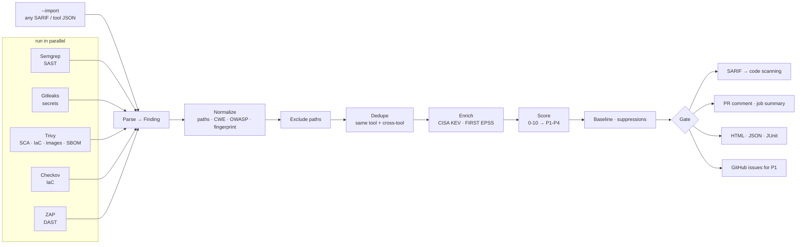

# Architecture

## Design decisions

**One normalized model.** Every adapter turns tool output into the same `Finding`
(`src/triagegate/models.py`). Everything downstream (dedupe, scoring, policy, reporters) is
tool-agnostic, so adding a scanner touches one file.

**Fingerprints from content, not line numbers.** Code findings hash the normalized matched
snippet, and dependency findings hash package + CVE (not the installed version). This keeps
baselines and GitHub issue tracking stable when unrelated lines move. Secrets use the line,
because their snippet is redacted.

**Dedupe in two stages** (`src/triagegate/normalize/__init__.py`):

1. *Exact.* Same fingerprint; same CVE in the same package and file; or several rules from one
   SAST tool flagging overlapping lines with the same CWE (Semgrep's Flask, Django and generic
   rules often fire on the same line).
2. *Cross-tool clustering.* Candidate pairs are ranked by evidence: a known-equivalent rule id
   (e.g. Trivy `AVD-DS-0002` ≡ Checkov `CKV_DOCKER_3`), then shared CWE, then similar titles,
   always on overlapping lines of the same file. They are merged greedily, and **a cluster may
   contain at most one finding per tool**. Without that rule, chains of weak matches merge
   distinct checks. In testing, five different S3 public-access checks collapsed into one
   finding before this constraint was added.

**Prioritize by exploitability.** A CVSS 9.8 nobody exploits matters less than a CVSS 7.5 in
CISA's KEV catalog. triagegate pulls KEV and EPSS (free, cached for 24h, and optional when offline)
and records the reason for every score adjustment.

**Fail on new, not on history.** Baselines and suppressions with expiry dates make it possible
to switch the gate on for a legacy repository on day one without blocking every PR.

**Never leak secrets.** Gitleaks runs with `--redact`, and the parser redacts again on top of
that. Snippets for secrets are never read from disk. Scanner output is untrusted: HTML reports
are auto-escaped and only `http(s)` links are rendered, and Markdown output has `@` mentions
neutralized so a malicious finding title cannot ping people.

**Supply chain of the tool itself.** Scanner binaries in the Docker image are pinned and verified
against SHA-256 values committed in the Dockerfile, not fetched at build time. CI actions are
pinned to commit SHAs. Release images are signed with cosign (keyless) and published with SBOM
and SLSA provenance attestations.

## Adding a scanner

1. Create `src/triagegate/scanners/<tool>.py` with a `Scanner` subclass:
   - `steps()` returns the commands to run, plus the file each one writes.
   - `parse()` turns the decoded JSON into `Finding` objects.
2. Register it in `src/triagegate/scanners/__init__.py`.
3. Add a config class in `src/triagegate/config.py`.
4. Capture real output into `tests/fixtures/<tool>.json` and add parser tests.
5. Install the binary (pinned and checksum-verified) in the `Dockerfile`.
